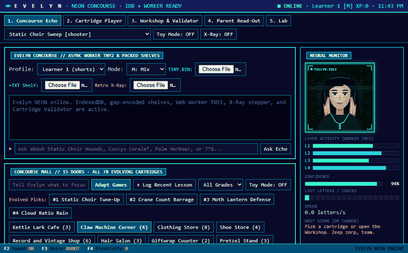
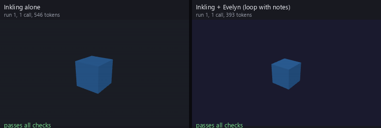
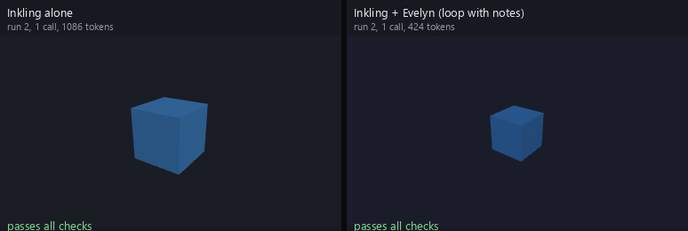
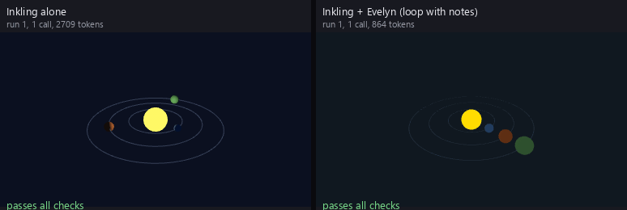
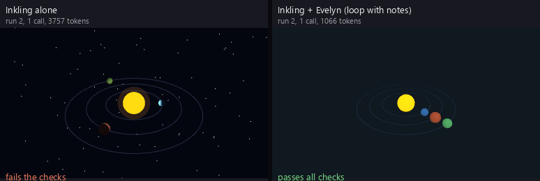
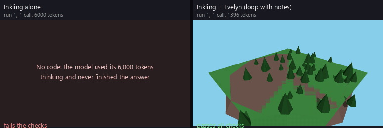
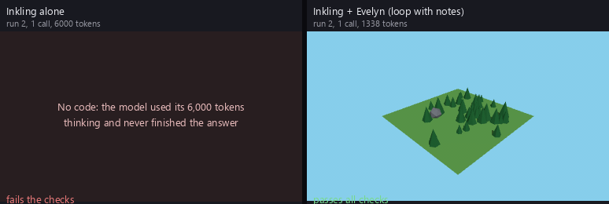

# Evelyn and her Echoes

**Evelyn Eliminates E-Waste.**

A computer that is too old for today's software is still a computer. Evelyn is written to run on the old machines people throw away: plain code, no network, no installs, little memory. The section [Reaching back: how old a machine can run it](#reaching-back-how-old-a-machine-can-run-it) says how far back each edition is meant to go and what has actually been tried.



More: [the portrait, 10 seconds](media/evelyn_face_float.gif) and [the cartridge player, validator, debugger and safety charter](media/evelyn_features.gif).

Evelyn is an offline tutor, adventure game and coding lab for computers with little memory and no network. It is based on Tiny2.1's idea of a small language model. This folder holds three editions of it, each with its own tests, plus tests that run the same script through all three and compare the output.

| Folder | Edition | Runs on |
| --- | --- | --- |
| `js/` | JavaScript (ES5, no dependencies) | any browser from a file, or Node |
| `c/` | C (C89 style) | any C compiler; written with old DOS compilers in mind |
| `basic/` | BASIC (QuickBASIC dialect, FreeBASIC `-lang qb`) | FreeBASIC, including DOS and Raspberry Pi targets |

The JavaScript edition is the reference. The other two are checked against it.

## What is in it

- **Library.** Text is compressed with 16-bit LZW, stored as base64, and indexed by word. `LIBRARY.EVL` is the file format; all three editions read and write the same file. A starter set of 16 facts is built in, and any `.txt` file can be added.
- **Neural engine.** A reader for the `TNY2` weight file (4 layers of width 96 for the real `TINY.BIN`) with an 8-bit KV cache. It answers one character at a time. The `KV21` format moves a cache from one model to another. The file layout is described under File formats below. No trained `TINY.BIN` was available here, so the tests use generated weights.
- **Learner profile.** The reading, audio, doing or mixed style, experience points, topics mastered, and the adventure state. `USER.CFG` is the file format.
- **Tutor.** Answers arithmetic itself, otherwise looks the question up in the library, shapes the answer to the learner's style, and adds the neural engine's text when a model is loaded.
- **Adventure.** Four rooms with a puzzle each, using the same library for hints.
- **Coding lab.** A small language (`LET`, `PRINT`, `IF..THEN`, `REPEAT`/`END`, `MOVE`, `TURN`, `CLEAR`) that draws on a 12 by 12 turtle grid and stops after 500 steps.
- **Extras in the JavaScript and C editions.** Several shelves of knowledge searched together with a checker that rejects numbers the sources do not hold, the 12-byte game packet and 6-byte-plus-weights bot packet for slow links, and the integer dot product for weak CPUs.

| Part | JS | C | BASIC |
| --- | --- | --- | --- |
| LZW and base64 | yes | yes | yes (dictionary of 4095 codes) |
| Library, ingest, `LIBRARY.EVL` | yes | yes | yes (1000 entries) |
| `TNY2` engine, greedy answers | yes | yes | yes |
| Sampling with a seed | yes | yes | no |
| `KV21` export and import | yes | yes | no (a primed prefix works) |
| Profile and `USER.CFG` | yes | yes | yes |
| Tutor, adventure, coding lab | yes | yes | yes |
| Several shelves and the checker | yes | yes | no |
| Packets and the integer dot | yes | yes | no |
| Browser page | yes | | |

## Running it

```powershell
node js\evelyn_cli.js                      # terminal
start js\index.html                        # browser, nothing to install
c\build.bat ; c\out\evelyn.exe             # C, Visual Studio compiler (or: make -C c)
node tests\qbi.js basic\evelyn.bas         # BASIC in the bundled interpreter
basic\build.bat ; basic\evelyn.exe         # BASIC with FreeBASIC (fbc on the PATH)
```

All three programs take the same commands: a question, `/mode R|A|D|M`, `/adv` to enter or leave the adventure, `/code LET a=4;PRINT a*a`, `/profile` and `/quit`. Pass a `.BIN` file to load a `TNY2` model and any other file to add it to the library.

## What each edition can do

| | JavaScript (`js/`, plus `caldarium/`) | C (`c/`) | BASIC (`basic/`) |
| --- | --- | --- | --- |
| Offline library: add text, search, `LIBRARY.EVL` | yes | yes | yes, up to 1000 entries |
| `TNY2` neural engine, answers one letter at a time | yes, greedy or sampled | yes, greedy or sampled | yes, greedy only |
| Move a `KV21` cache between models | yes | yes | no (a primed prefix works) |
| Layer streaming: one layer in memory, per-layer checks | **yes** (`evelyn_stream.js`) | not yet | not yet |
| Learner profile, `USER.CFG` | yes | yes | yes |
| Tutor (arithmetic, library lookup, answer shaped to the learner's style) | yes | yes | yes |
| Adventure (four rooms with puzzles) | yes | yes | yes |
| Coding lab (turtle grid language, 500-step limit) | yes | yes | yes |
| Several shelves with the number checker | yes | yes | no |
| Game and bot packets, integer dot product | yes | yes | no |
| Runs from a web page with nothing installed | yes (`js/index.html`) | no | no |
| Concourse with 78 games, Echo and DritchChum pets, Lab (game X-ray, 3D viewer, SQL, code check), robot simulator, book games | yes (`caldarium/`) | no | no |
| Terminal program | `node js/evelyn_cli.js` | `evelyn.exe` | `evelyn.exe` (FreeBASIC) |
| Use as a library in your own program | `require` or a script tag | `evelyn.h` | no (a program, not a library) |

The JavaScript edition is the only one that has everything. C and BASIC cover the core: library, engine, tutor, adventure and coding lab. The cross-edition tests keep their answers identical to JavaScript's for the parts they share.

## Layer streaming (JavaScript only, `js/evelyn_stream.js`)

Inspired by [AirLLM](https://github.com/lyogavin/airllm) (Apache-2.0), which runs a large model on a small graphics card by loading one layer, running it and dropping it. Evelyn applies the same idea to the `TNY2` file for machines that cannot hold all of it: no AirLLM code or Python is used (see `CREDITS.md`).

```js
var S = require("./evelyn_stream.js");                     // or the global EvelynStream in a page
var manifest = S.buildSovereignManifest(buffer);            // a CRC32 pin for every layer
var m = new S.Tiny2StreamModel();
m.loadFromBuffer(buffer, "slice", manifest);                // "resident" parses all layers now
var a = m.think("capital of estonia");                      // { text, stats }
// a.stats: layersLoaded, bytesRead, lettersPerSec  (counted, not estimated)
```

- **`layerAt(l)`** returns a layer from one of three sources: *resident* (all layers parsed up front), *slice* (parsed from the file buffer when asked, then dropped) or *prefetch* (an asynchronous fetcher such as IndexedDB or a file read; layer l+1 is asked for while layer l computes). `thinkAsync(question, maxNew, callback)` uses the prefetch source; `splitTny2Shards(buffer)` cuts a file into a base part, one shard per layer and the final gains, as they would be stored separately.
- **Zero-copy views.** A whole weight table is one `Int8Array` view into the source buffer (a row starts every `4 + cols` bytes, after its 4-byte scale); no weight byte is copied and no view is made per row. Before 2026-11-23 each row had its own view object, 380 or so per layer, made again every time a layer was loaded. `rowView(table, r)` makes a view of one row when a caller wants one.
- **Layer-order prefill.** The whole question goes through layer 0, then layer 1, and so on, so a layer is loaded once for the question and once per letter written, instead of once per letter of the question. A 29-letter question on 2 layers costs 2 layer loads, not 58.
- **SovereignManifest.** CRC32 for the header, the token and position tables, every layer and the final gains. A flipped bit or a truncated layer is refused before it is used; the test flips one bit and checks that it is caught. In slice mode the file buffer stays in memory, so a layer is checked the first time it is used and not at every letter (the check reads all 90 KB of the layer, and a layer is read once per letter written). `model.source.verifyEvery = true` brings back the check at every use; a layer that arrives from a fetcher (prefetch mode) is always checked.
- **OffsetShelfStore.** The search index stays in memory and the full text of each entry stays in a blob (or a file) and is read by byte offset, with a CRC32 check, only when an entry is chosen.
- **Same answer.** The streamed text and every byte of the key and value caches equal `Evelyn.Tiny2Model` and the resident mode (`js/test/evelyn_stream_tests.js`, 10 checks, including the real `TINY.BIN` shape of 381,808 bytes).

**What it saves, honestly.** For the real shape (width 96, 4 layers) one layer is 89,728 bytes. Holding the whole file plus the caches takes 484,208 bytes; with layers coming from a fetcher, one layer in flight takes 215,024 bytes and two (read-ahead) 304,752. Streaming from a file buffer that is already whole in memory ("slice") saves no memory; it counts and checks each layer. The memory saving comes from a shard source. On this PC, with random weights, a 12-letter answer loaded 52 layers (4.4 MB of layer data checked) at about 400 to 500 letters a second. No real `TINY.BIN`, slow disk or old browser was tried, so the benefit on the machines it is meant for is arithmetic, not a measurement.

Run it: `node js/test/evelyn_stream_tests.js` (also a step of `node tests/run_all.js`).

## Speed work and benchmarks (2026-11-23)

A review of the code (an AI Studio chat, see `CREDITS.md`) proposed a benchmark suite and a list of speed-ups. Each proposal was written again here, compared with the code as it was (`js/test/legacy/` keeps the two files from before) and measured. What was kept, what was left out and why:

```powershell
node tests\bench_evelyn.js                 # all five sections, old code against new code and against outside baselines
node tests\bench_evelyn.js --quick --only=2,3
node --jitless tests\bench_evelyn.js --quick --only=3   # the engine with the JIT off, as an old browser runs it
node js\test\evelyn_fast_tests.js          # 33 parity tests
```

| Part | What changed | Result, Node 25 on this PC | Output |
| --- | --- | --- | --- |
| LZW compressor | a chained hash of 4096 buckets (8 KB, shifts and xors, no multiply) instead of a dictionary keyed by strings; scratch tables made once and cleared by walking the buckets that were used | one 137-character fact 12.8 times as fast, 48 KB of prose 6.8 times, 20 KB of noise 7.4 times | the same bytes, also after the dictionary is full |
| Base64 | a 128-byte lookup table for decoding (the old code searched the 64 letters for every character), character codes joined in blocks for encoding | decode 10.1 times as fast, encode 3.4 times | the same text as Node's `Buffer` |
| LZW decompressor | the codes are read from the bytes in one pass | 1.2 times as fast | the same text and the same errors |
| Coding lab | each line is decoded the first time it runs and kept; the words of an expression are cut once and cached; the parser makes no closures | a 40-pass loop with the turtle 4.3 times as fast; a one-line program 1.05 times | the same result, error text, step count and grid on 6000 generated programs, good and bad |
| Library search | the lower-case topic is kept beside the record, scores sit in a typed array, the best 1 to 8 are picked without sorting everything | 64 entries 1.6 times, 960 entries 1.8 times, 4000 entries 2.0 times as fast | the same hits in the same order |
| Number checker (JavaScript and C) | a number of the draft must be a whole number of the sources | a draft saying 100 against a source that says 1000 is refused (it was accepted) | **changed on purpose**; the C unit test `evl_number_in` and the conformance run cover it |
| Layer streaming, slice mode | one view per table; a layer's CRC32 once per buffer | 2.6 times as fast with a manifest | the same text and cache bytes |
| Second feed-forward product | the columns that are zero after the ReLU are skipped when over half are | 1.2 times at half zeros and 3.0 times at four fifths on a JIT, 1.7 to 3.9 times with no JIT | the same bits |

Left out, because the measurement said no. **Unrolling the product loop by four** was suggested for every matrix: it was 13% slower on a current JIT and 10% faster in an interpreter, so the plain loop stays. **The integer engine** (`js/evelyn_potato.js`: Int8 activations, 32-bit integer sums, an exponential table, skipped attention positions) is optional and off. On a current JIT it runs at 0.83 to 0.88 times the speed of the float engine; with the JIT off it runs 1.4 times as fast. It also changes the scores in the third or fourth digit, so the C and BASIC editions, which are checked against the JavaScript scores, cannot match it. Its second level, the exponential table and the attention work, added nothing measurable over its first. The module reports how far the answers move (`compare`), measured on random weights: the cosine of the scores is 0.9998, the best letter is the same 98 to 99.6% of the time and a whole 30-letter answer is the same in 1 to 2 of 10 prompts. Random weights make the scores nearly flat, so a trained `TINY.BIN` has to be measured the same way before the module is used for anything.

Not measured: a real old machine, a real old browser, a trained `TINY.BIN`, the C edition's speed (it was not changed except for the number checker). The statement that the changes help a 1995 computer is therefore a reading of the interpreter-only run and not a result.

## Working with a local Inkling (JavaScript only)

Evelyn can stand in front of a language model that runs on the same machine and speaks the OpenAI chat format, such as llama-server with the Inkling 2 Mini GGUF. The files below came from a design written in an AI Studio chat (see `CREDITS.md`) and were changed where reading the code showed a fault.

| File | What it does |
| --- | --- |
| `js/evelyn_inkling_agent.js` | `EvelynInklingAgent.ask(question, cb)`: a sum of two whole numbers is answered by `CodeSandbox` with no model call; otherwise the question is searched in an `OffsetShelfStore` (only the matching byte slices are read, each CRC32 checked), the model is asked with effort `low` when excerpts were found and `medium` when none were, and every number of the draft must be a whole number of the excerpts or of the question. A draft that fails is sent back once with the list of numbers that are missing; if the second draft still fails, the answer is the shelf text. `InklingClient` is the HTTP client. |
| `js/evelyn_cascade.js` | `KV21SubagentPool` primes a role ("ROUTE:", "KEYWORDS:") on a `Tiny2Model` once and keeps its cache as a KV21 snapshot; switching roles is one `importKVCache`. `thinkWithMargin` reads the gap between the best and second best letter score of each step. `TieredEvelynOrchestrator` uses a confident expander to widen the shelf search, a confident router to pick the effort (an unsure router gets `medium`), and calls the model only when no shelf answer is wanted. |
| `js/evelyn_gguf_driver.js` | `EvelynInklingDriver` drives llama-server: a GBNF grammar built from the shelf ids that were found (`buildGroundedGrammar`), a streamed generation that cuts a repeating stretch (`loopDetected`) and reads ahead a shelf the model names while it thinks, and `checkpoint` / `rewind` of a server slot. |
| `js/evelyn_inkling_codeloop.js` | `EvelynCodeLoop`: for a task that asks for code, search the notes, ask Inkling, RUN the code with a verifier the caller gives, send the exact errors back for up to `maxRepairs` repairs. `extractCode` takes the fenced block. The verifier used by the tests is `js/test/three_verify_worker.js` (three r187, Node permission model on). |
| `js/evelyn_tny3.js` | The `TNY3` header: vocabulary, context length, width, layers, heads, feed-forward size, a rotary-position flag and a count of assistant outputs, in 24 bytes, with a header writer and a parameter estimate. Only the header. The weight layout, rotary attention and the output heads are not written, and `Tiny2Model` refuses a `TNY3` file. |

```js
var A = require("./evelyn_inkling_agent.js");
var client = new A.InklingClient({ port: 8080, maxTokens: 1500 });
var agent = new A.EvelynInklingAgent(offsetShelfStore, profileManager, client);
agent.ask("Where is Frostgate?", function (err, r) { /* r.answer, r.path, r.verified, r.inklingCalled */ });
```

**Tested.** `node js/test/evelyn_inkling_tests.js` (49 checks, a step of `node tests/run_all.js`) runs all of it against a small mock server in the test file that plays llama-server: the request bodies, the effort fields, the repair pass for a wrong number and for an invented source, HTTP errors and a closed port (each reported once), the KV21 switch giving the same letters and margins every time, the margin equal to a hand-written computation, the routing rules, a repeating stream cut and the server seeing the client leave, ordinary JSON output not cut, a shelf read ahead, slot calls, the code loop, the `TNY3` header round trip and refusals, and the three.js verifier on known good code, eleven known faults and an attempt to write a file from inside the checked code (refused by Node's permission model).

**Measured on the real Inkling (2026-11-23).** Inkling 2 Mini Q4_K_M on LM Studio's llama.cpp runtime (server build b1-29b52d3), the RTX 3090, context 32768, 8-bit cache, started through the GPU queue. `node js/test/evelyn_inkling_live.js --port <port>` repeats these and passes 6 of 6.

- **Effort.** The words map to `low` 0.2, `medium` 0.7, `high` 0.9 in the system message the template writes. A number in the top-level `reasoning_effort` field is ignored (it becomes 0.9) and an unknown word is HTTP 500. A number works in `chat_template_kwargs.reasoning_effort`, rounded to one decimal (0.35 became 0.3, 0.05 became 0.0). `InklingClient` and the driver send numbers that way. On one short sum the model wrote 51 tokens at 0.0, 78 at `low`, 93 at 0.9: about 1.8 times fewer, on one trivial question, so the chat's "2 to 5 times" is not confirmed.
- **Grammar.** The server applies a grammar: the output is valid JSON and the sources are only the ids given. It also stops the model thinking, and the answer string was a placeholder (`"..."`) in 7 of 8 runs on two prompts. A minimum length for the string made the model ramble to the token limit, so that option was removed. `grammar_lazy` with a trigger on the answer's start token was ignored by this build. With a grammar on, the stream has no text deltas; the whole text is in `__lmstudio.model_output` of the last event, which the driver reads. For an answer, let the model think and check the cited ids afterwards (`verifyCitationsAgainstHits`).
- **Loop cut.** A prompt that asks for one sentence forever was cut after 1,166 letters and 4.8 s.
- **Slots.** `/slots?action=save` answers 501: this server was not started with `--slot-save-path`, so checkpoint and rewind are untested on a real server.
- **Agent.** A grounded question about the shelf was answered in 4.5 s with the right numbers and a real citation; a sum took no model call.

**Writing three.js code with and without Evelyn.** `node js/test/evelyn_threejs_bench.js --port <port> --trials 2` asks Inkling for three scenes (a spinning cube, a solar system, a low-poly island with instanced trees) in three ways, with the same seeds, and scores every final code with one verifier: it runs the code against the real three r187 in a child process and checks the scene graph (no renderer, no picture). `alone` is one call at effort `high`; `loop` is `js/evelyn_inkling_codeloop.js` with no notes (run the code, send the exact errors back, up to 2 repairs); `notes` is the same loop plus verified three r187 notes retrieved from an `OffsetShelfStore`, at effort `low` as the agent's rule says when notes are found. Results, 6 runs per row:

| Condition | First draft passes | Final passes | Calls per run | Tokens per run (with thinking) | Seconds per run |
| --- | --- | --- | --- | --- | --- |
| Inkling alone | 3 of 6 | 3 of 6 | 1.0 | 3,350 | 64 |
| Evelyn loop, no notes | 5 of 6 | 6 of 6 | 1.2 | 3,177 | 61 |
| Evelyn loop with notes | 6 of 6 | 6 of 6 | 1.0 | 914 | 18 |

How to read it. The three failures of Inkling alone were two island runs that used all 6,000 tokens thinking at high effort (one never wrote code, one stopped inside the code block) and one solar system with five spheres where four were asked for. The loop's one repaired run was an island whose first draft failed a check. The notes were written by the same hand as the checks, so that row shows what retrieval can do when the right note exists. It is not an unbiased accuracy, and `alone` also differs in effort, not only in help. Six runs a row is a small sample and the 6,000-token limit decides some of the baseline's failures. Inkling here is the same model served by LM Studio's llama.cpp runtime for every row; the LM Studio application window was not used, because loading a model through it skips the GPU queue.

### The scenes they made, side by side

Each picture below puts the code of Inkling alone (left) next to the code of Inkling with Evelyn, the loop with notes (right), for the same task and the same seed. All 6 runs of the table above are shown, 3 tasks with 2 runs each. The code of all 16 scenes that were written is in [`examples/threejs/`](examples/threejs/), unchanged, with a short comment on top that says which condition made it and what the checks said. `examples/threejs/bench_results.json` has the numbers of every run without the code.

**Spinning cube, run 1.** Task: one lit cube (BoxGeometry) that spins, a light and a camera that sees it.



Code: Inkling alone (no code: it used all 6,000 tokens thinking and the reply had no finished code block) · Evelyn loop, no notes (no code: it used all 6,000 tokens thinking and the reply had no finished code block) · Evelyn loop with notes (no code: it used all 6,000 tokens thinking and the reply had no finished code block)


**Spinning cube, run 2.** Task: one lit cube (BoxGeometry) that spins, a light and a camera that sees it.



Code: Inkling alone (no code: it used all 6,000 tokens thinking and the reply had no finished code block) · Evelyn loop, no notes (no code: it used all 6,000 tokens thinking and the reply had no finished code block) · Evelyn loop with notes (no code: it used all 6,000 tokens thinking and the reply had no finished code block)


**Solar system, run 1.** Task: a glowing sun at the origin and exactly three planets on circular orbits of different radii, a light, no moons.



Code: Inkling alone (no code: it used all 6,000 tokens thinking and the reply had no finished code block) · Evelyn loop, no notes (no code: it used all 6,000 tokens thinking and the reply had no finished code block) · Evelyn loop with notes (no code: it used all 6,000 tokens thinking and the reply had no finished code block)


**Solar system, run 2.** Task: a glowing sun at the origin and exactly three planets on circular orbits of different radii, a light, no moons.



Code: Inkling alone (no code: it used all 6,000 tokens thinking and the reply had no finished code block) · Evelyn loop, no notes (no code: it used all 6,000 tokens thinking and the reply had no finished code block) · Evelyn loop with notes (no code: it used all 6,000 tokens thinking and the reply had no finished code block)


**Low-poly island with instanced trees, run 1.** Task: a horizontal ground of at least 20 by 20 that receives shadows, at least 30 trees as one InstancedMesh that cast shadows, a DirectionalLight with shadows, and a camera that looks from above and to the side.



Code: Inkling alone (no code: it used all 6,000 tokens thinking and the reply had no finished code block) · Evelyn loop, no notes (no code: it used all 6,000 tokens thinking and the reply had no finished code block) · Evelyn loop with notes (no code: it used all 6,000 tokens thinking and the reply had no finished code block)


**Low-poly island with instanced trees, run 2.** Task: a horizontal ground of at least 20 by 20 that receives shadows, at least 30 trees as one InstancedMesh that cast shadows, a DirectionalLight with shadows, and a camera that looks from above and to the side.



Code: Inkling alone (no code: it used all 6,000 tokens thinking and the reply had no finished code block) · Evelyn loop, no notes (no code: it used all 6,000 tokens thinking and the reply had no finished code block) · Evelyn loop with notes (no code: it used all 6,000 tokens thinking and the reply had no finished code block)


How the pictures were made (`tools/threejs_showcase.py`). Each scene is drawn in a headless Brave with software rendering, so no graphics card was used. The canvas is 384 by 216 and the camera's aspect is set to match. `Math.random` is replaced by a seeded generator so the picture can be drawn again. The island scene does not move, so for it only, the camera circles the origin once; every other scene is drawn exactly as its `update(t)` moves it, 10 pictures a second for 6 seconds. The page blocks every network request from the model's code. Pass and fail come from the checker, `js/test/three_verify_worker.js`. I did not watch the GIFs, so nothing here says how good a scene looks, only whether its code passed the checks. The code files are model output and were not edited; Inkling 2 Mini's terms for reusing its output were not looked up.

```powershell
python tools/threejs_showcase.py --three-dir <folder with three.module.js and three.core.js>
```

**Not measured.** The chat's other claims: that 40 to 70 percent of queries can stop at the small tiers, and that a larger context and a 4,096-entry vocabulary help the assistant. The small model is the `TNY2` engine with random test weights (no trained `TINY.BIN` exists), so what a trained router or expander would decide is open. The loop cut was changed from the design: it needs the same 48 letters to have appeared twice before, because a code listing or a JSON list can repeat a line once; `loopRepeats: 1` gives the original rule.

## Reaching back: how old a machine can run it

The aim is that old hardware keeps working. These are the oldest targets each edition is written for, and what has actually been run. **No machine older than a current PC was used for any test.** The "written for" column comes from the language features and library calls the code uses; it is a design target, not a result.

| Edition | Written for | Why that is the floor | Actually run |
| --- | --- | --- | --- |
| JavaScript, in a browser | About 2011 to 2012 browsers: Internet Explorer 10, Firefox 15, Chrome 9, Safari 5.1, Android 4.0 | The code is ES5 (no arrow functions, `let`, `const`, modules or promises) and needs typed arrays and `DataView`, which those browsers introduced. Opened from a file; no server. Browser speech and sound are optional extras. | Brave (current) |
| JavaScript, in Node | Any Node with typed arrays | Same code, no packages | Node 25 |
| C | Any C89 compiler with a 32-bit `unsigned long` and IEEE `float`; written with Turbo C and other DOS-era compilers in mind | C89 declarations and comments, one `#ifdef __TURBOC__` for the PC speaker, `-std=c89 -pedantic` in the Makefile | Visual Studio's `cl` only. gcc, Turbo C and DOS were not tried |
| BASIC | FreeBASIC `-lang qb` (QuickBASIC dialect) for DOS, Windows, Linux and Raspberry Pi | 16-bit `INTEGER` rules are followed; the model tables take about 700 KB, so it needs more than the 640 KB of plain DOS memory, which means FreeBASIC's 32-bit DOS target (a 386 or later, as far as I know) | The bundled interpreter `tests/qbi.js` only. FreeBASIC was not installed |
| Layer streaming | Same as the JavaScript edition | Also needs `Date.now` and `Object.create`, both ES5 | Node 25 |

What would extend the reach: a C build of the layer streaming for DOS machines (not done), BASIC streaming (not done), and a test on a real old browser or a real DOS machine (not done).

## Tests

```powershell
node tests\run_all.js
```

This runs, in order: generated files are current, BASIC names avoid keywords, no stray control characters, the JavaScript unit tests (48), the JavaScript layer-streaming tests (10), the speed-work parity tests (33), a quick run of the benchmark suite (it fails when the new code differs from the old), the BASIC interpreter tests (49), the C build, the C unit tests (222), the cross-edition conformance run, and the command line programs for all three (24 checks).

**Conformance.** `tests/conformance.txt` is one script of 228 commands in six sections: core (180), kv (12), sampling (11), swarm (11), net (11) and full (3). Each edition has a small driver (`js/evelyn_proto.js`, `c/evelyn_proto.c`, `basic/evelyn_proto.bas`) that reads the script and prints one result line per command. `tests/run_conformance.js` runs the script through every edition and compares the lines with the JavaScript output. Score lines may differ in the sixth decimal; every other line must be identical. It also compares the files the editions write (`LIBRARY.EVL`, `USER.CFG`, `KV21` caches) byte for byte, and feeds each edition the files the JavaScript edition wrote. The neural engine is checked on generated models, including one with the real `TINY.BIN` shape (JavaScript and C).

Result on this machine: JavaScript and C agree on 1135 output lines in all six sections, and BASIC agrees on the 1011 lines of the core section, with byte-identical files.

**Planted bugs.** The suite was tried against deliberate faults (a changed ranking weight, a changed rounding rule in the KV quantizer, a changed note frequency in C, a changed rounding rule in BASIC). Each was reported by at least one test.

## What has and has not been checked

- The JavaScript edition ran in Node 25 and in a real browser (the page loads, answers, runs the adventure and the coding lab, and saves the profile).
- The C edition was compiled with Visual Studio's compiler (`cl`). It is written to C89 rules and has a Makefile for gcc with `-std=c89 -pedantic`, but no gcc was available to try it. The DOS and Turbo C code paths (`sound()`, huge pointers) were not compiled.
- **The BASIC edition was not compiled with FreeBASIC, which is not installed here.** It ran in `tests/qbi.js`, an interpreter for the subset of BASIC it uses. The interpreter is strict on purpose: it refuses undeclared variables, stops on 16-bit INTEGER overflow, rounds SINGLE values to 32 bits at every step, and requires exact types for by-reference arguments. That catches the usual mistakes, but only a real compiler shows whether the declarations and file statements are accepted. The first thing to try on a machine with FreeBASIC is `node tests\run_conformance.js`: when `fbc` is on the PATH it compiles `basic/evelyn_proto.bas` and compares that program with the JavaScript edition too.
- No real `TINY.BIN` was available. When you have one, run the same question through `TINY.EXE` and through `node js\evelyn_cli.js --bin TINY.BIN` and compare.

## Design decisions

Evelyn is based on Tiny-2.1's idea of a small language model that answers one letter at a time. It contains no code, data or trained weights from that project (see `CREDITS.md`). These are the rules the three editions share, written down so that they agree and the tests can check exact answers.

**Names and storage**
- The namespace is `Evelyn`. In a browser `Oasis` stays as an alias, so older pages keep working.
- In a browser the profile and library live in `localStorage`. Node 25 prints a warning when its global `localStorage` is touched, so Node uses a folder instead (`Storage.useDirectory`).

**Library and tutor**
- Library search lists higher scores first and, on a tie, the lower entry number.
- The multi-shelf checker ignores the `[shelf#id]` tags when it looks for numbers; with the tags counted, almost every answer was rejected.
- A solved puzzle awards the experience points its reward text names (20, 20, 20 and 50).
- `bestLearnedMode` returns the learner's current mode when no mode has a count yet.

**Coding lab**
- Conditions accept `=` as well as `==`; variable names ignore case; strings join with `+`; numbers print with at most six decimals.

**Neural engine and formats**
- The `KV21` header lists the width first, then the layer count, then the length, in the JavaScript and C editions (BASIC has no `KV21` export).
- `Tiny2Model.prime(text)` feeds text as a prefix that stays in the cache. A prefix exported from one model can be imported by another, and the second model continues exactly where the first stood.
- `js/evelyn_stream.js` (layer streaming, JavaScript only) gives the same answers as `Tiny2Model`, letter for letter and byte for byte in the cache, so a machine that cannot hold the whole weight file can still use it.

**Where things are, and what is left out**
- The micro game demo (a Verlet rope and bots that evolve live on the CPU) is `caldarium/game_engine_demo.html`, JavaScript only.
- The C and BASIC editions cover the core (library, engine, tutor, adventure, coding lab). The Caldarium, the Echo and DritchChum pets and the Lab exist only in JavaScript.

## Folders

```
js/       evelyn_core.js  evelyn_stream.js  evelyn_potato.js  evelyn_cli.js  evelyn_proto.js  index.html  test/test_evelyn.js  test/evelyn_stream_tests.js  test/evelyn_fast_tests.js  test/legacy/
c/        evelyn.h  evelyn.c  evelyn_data.h  evelyn_cli.c  evelyn_proto.c  evelyn_test.c  build.bat  Makefile
basic/    evelyn_core.bi  evelyn_data.bi  evelyn_io.bi  evelyn_decl.bi  evelyn.bas  evelyn_proto.bas  build.bat  build.sh
tools/    make_test_model.js  gen_data.js  gen_decl.js  check_bas_names.js  bas_keywords.json
tests/    run_all.js  bench_evelyn.js  run_conformance.js  conformance.txt  qbi.js  test_qbi.js  test_clis.js
```

`evelyn_data.h` and `evelyn_data.bi` are generated from `js/evelyn_core.js` by `node tools\gen_data.js`, so the starter facts, rooms and lessons exist once. `evelyn_decl.bi` is generated by `node tools\gen_decl.js`. After changing a fact, a room or a procedure header, run both; `run_all.js` fails when they are out of date.

## File formats

- **`TNY2`**: `TNY2`, then width, layers, heads and hidden size as 16-bit numbers; then the token table (97 rows), the position table (128 rows), then for each layer the gains, the q, k, v and o tables, the gains and the two feed-forward tables; then the final gains. A table row is a 32-bit float scale followed by one signed byte per column. All numbers are little endian.
- **`KV21`**: `KV21`, width, layers and length as 16-bit numbers; then for each layer and position the key scale, the key bytes, the value scale and the value bytes.
- **`LIBRARY.EVL`**: one line per entry, `topic TAB category TAB fact TAB example`, where the fact and the example are base64 text of the LZW codes.
- **`USER.CFG`**: `KEY=value` lines (`NAME`, `MODE`, `PACE`, `XP`, `FB`, `ROOM`, `SOLVED`, `INV`, `MASTERED`, `RECENT`); lists are joined with `|`.
- **Game packet**: player, buttons, sequence (16 bits), then x, y (units of 1/16) and vx, vy (units of 1/256) as signed 16-bit numbers. **Bot packet**: weight count (16 bits), a 32-bit float scale, one signed byte per weight.

## The Caldarium (`caldarium/`, added 2026-11-22)

A second, browser-first JavaScript stack builds on the same ideas. It lives in `caldarium/`, all ES5, no dependencies, Node or browser, and it is separate from the `js/` reference edition (its own `EvelynBackend`, IndexedDB shelves, Web Worker `TNY2`).

| File | What it is |
| --- | --- |
| `evelyn_backend.js`, `evelyn_cartridges.js` | storage (IndexedDB, fallback), shelves, Worker `TNY2`, SM-2, audio; the `.cart.json` validator, canon tables, sand engine |
| `evelyn_concourse.html` | the playable hub (open it from a file); `evelyn_caldarium.html` is the earlier single-file version |
| `evelyn_evolution.js`, `evelyn_suite_78.js`, `evelyn_suite_integration.js` | 78 cartridges in 15 doors; decks of 24 that adapt to recent lessons and the learner's stated focus |
| `evelyn_voice_guard.js`, `evelyn_director.js` | runtime AI-tic filter; reactive world state between games and camera framing |
| `evelyn_frontier.js`, `evelyn_robotics.js`, `evelyn_bot_rx/` | graph memory, grammar decoding and related systems; robot simulator, safety governor, Arduino receiver sketch |
| `evelyn_sentinel.js`, `evelyn_charter.js` | CRC32 envelopes, atomic store, scrubber; sealed ethos, zero-harm gate, read-only OBD-II |
| `evelyn_doctor.js`, `evelyn_art.js` | self-repair and watchdogs; CRT portrait and favicon |
| `evelyn_net.js`, `game_engine_demo.html` | packet codecs; the micro game engine demo |
| **`evelyn_chums.js`** (+ generated `evelyn_chums_data.js`) | **the DritchChum / Echo pet raising system** |

**DritchChums and Echoes (owner ruling, 2026-11-22).** The pet raising system is the DritchChum system of Scar Brand (`BocaDeAmourGame_2026-11-21/PLAN_SCAR_BRAND_ADAPTATION.md` section 6). "Echo" and "DritchChum" are interchangeable words for the same creatures and the same code (`EvelynChums`, also `EvelynEchoes` and `EvelynDritchChums`; chat commands accept either word). By convention the nice creatures are Echoes and the nastier ones DritchChums, and every pair can become friends in the right circumstances (shared meal, story night, storm shelter, mending circle, hum chorus, a lost kit; races and duels make friendly rivals). **Pets are never humanoid women:** species come only from the `creature` records of `CharacterDatabase` (111: 52 Echoes, 59 DritchChums; the 47 humanoids are never pets, and the generator drops any creature whose text describes a woman or girl). Rules taken from the plan: stats (Stand, Reach, Glide, Keep, Hum) show as thread weight and colour, never as numbers; nothing is hurt on screen; a creature with three days of no care is released to its home, kindly (a month away costs at most two days); kin of the same creature only, with inherited palette, stitch affinity and a 30-weight brain (36 bytes); care questions come from the species table (weak to, resists, home, how it eats) and a wrong answer never costs anything. DritchChums play harmless pranks and grow stats faster; Echoes trust sooner. The species file is generated: `node tools/gen_chums.js` (`--check` is part of `run_all.js`).

**The loft screen** (in `evelyn_concourse.html`, below the Adopt row once two creatures are in the loft): a track where "Race everyone" runs animated lanes (the winner's bar reaches the end, nobody is hurt), a duel stage ("hold the last note", the loser still gets a ribbon) and a meeting corner where two creatures meet in a chosen friendly circumstance and the screen says how they feel. Races and duels grow friendly rivalry bonds between the racers or duellists, and the header counts the two cups.

**Shared with the Scar Brand game.** `BocaDeAmourGame_2026-11-21/data/chums/` (`species.json`, `rules.json`) is generated from this module by `BocaDeAmourGame_2026-11-21/tools/build_chums.js`; `tools/test_chums_link.js` there (run by `run_all.js`) fails when the game's data and the module drift apart. The game keeps the plan's Ledger rule as a flag: 52 of the 111 species have a Ledger entity of the same name and are `playable` there (19 Echoes, 33 DritchChums); the rest stay `ledger: null` until the owner rules. Change the care, bond, kin or release rules here and run `node tools/build_chums.js` in the game folder.

**Changes made while placing the Caldarium code** (each found by running the suites):
- The ES5 audits in seven test files matched the regular-expression text that does the matching (`=>`); the pattern is now built at run time.
- `evelyn_suite_78.js`: a wrong-answer choice said "noon" where the suite's canon rule wants 12-hour clocks written out; now "ROOM-P1 12 PM".
- `evelyn_evolution.js`: a cartridge whose subjects map to the small fixed question banks (The Umbrella Doors: geography plus coding) stalled at 10 items; the deck is now topped up from the generators that never run out, so every cartridge reaches 24.
- `evelyn_voice_guard.js`: "isn't just about X, it's about Y" was not flagged (only "not just" and "isn't about"); the rule-of-three list missed "-sion" words.
- `evelyn_frontier.js`: the shelf-citation grammar had no length limit, so with random logits it never reached `#` inside 16 characters; names are now 2 to 8 letters.
- `evelyn_robotics.js`: the PID controller now stops integrating while the output is pinned at a limit (anti-windup); `evelyn_robotics_tests.js` uses a slower integral gain (0.05), because with 0.15 the loop still overshot by 5 percent at 4 seconds.
- `evelyn_net.js` is exported for Node as well as the browser; `evelyn_concourse.html` loads every module and mounts the portrait, doctor, hub, director, voice guard, charter gate and Chum Loft, rebuilt when the profile changes; `evelyn_test_runner.html` runs every suite.

**Checked:** `node tests/run_all.js` runs the nine Node suites of `caldarium/` (17, 6, 7, 8, 8, 6, 6, 4 and 10 checks) and `tests/check_caldarium_browser.py`, which starts its own server and drives real Brave: all suites in the page (64 checks; the eight Node-only audits are skipped there), the concourse (15 doors, 78 cartridges, portrait, loft, adopting an Echo and a DritchChum, chat commands with either word, opening a cartridge, the loft surviving a reload through IndexedDB), and the other two pages load without errors.

**Not checked, and left:** the Arduino sketch (`caldarium/evelyn_bot_rx/`) was not compiled and the Web Serial robot bridge never touched hardware; no phone, old browser (IE or 2012 builds) or real `TINY.BIN`; the speech and sound paths were not listened to; the C and BASIC editions have no chum system (the Caldarium is JavaScript only); the frontier, robotics and sentinel modules are tested but have no screen in the concourse; the Kaizostria cartridge plan in `cartridges/` still calls the phonics sound-creatures "Echoes" with no raising loop, which fits the new meaning but is not yet linked to the loft.

## The Caldarium, round 2

This round adds 41 code files, all in `caldarium/`, each with its own tests. The changes made while placing them are listed below (mostly the ES5-audit fix in test files). `CREDITS.md` lists, with links and licences, the papers, repositories, posts and pages the code drew on.

| Module (all ES5, no network) | What it does | Tests |
| --- | --- | --- |
| `evelyn_game_xray.js`, `evelyn_game_xray_gen6.js` | take apart a game file on the device: NES, Game Boy, WAD, DOS, ISO, CHIP-8, Mega Drive, N64, PS1, GBA, Dreamcast, GameCube, PS2 (6502 and MIPS listings, tile decoding, entropy map) | 5 + 6 |
| `evelyn_asset_studio.js` | sprite animator, tilemap swap, 2bpp encoder, IPS patcher, palette contrast audit | 6 |
| `evelyn_3d.js` | CPU z-buffer rasterizer, `.OBJ` reader and writer, 2.5D raycaster | 6 |
| `evelyn_code_forge.js`, `evelyn_ast_ide.js` | MiniHistory, MiniSQL, 6502 assembler and VM, app exporter; AST linter, autocomplete, safe rename, Big-O profile | 5 + 5 (in `turbo`) |
| `evelyn_wasm_accel.js`, `evelyn_code_engine.js`, `evelyn_bridge.js` | hand-written WebAssembly `i8_dot`, BPE, RoPE, fill-in-the-middle, prefix cache; the optional companion server | 5 (`turbo`) |
| `evelyn_hybrid_rag.js`, `evelyn_code_power.js`, `evelyn_lang_core.js`, `evelyn_manual_compiler.js` | code retrieval; safe patcher and call-graph slicer; a four-family language core; manual-to-JSON compiler | 5, 5, 5, 4 |
| `evelyn_paper_boost.js`, `2`, `3`, `evelyn_window_engine.js`, `evelyn_late2026_core.js`, `evelyn_agent_os.js`, `evelyn_sovereign_local.js` | the 2026 paper mechanisms, the looped and sliding-window engine, eight small-hardware adaptations, eight agent-platform pillars, backend auto-benchmark and a LAN layer pool (simulation only) | 7, 6, 7, 6, 7, 6, 5 |
| **`evelyn_lab.js`** (new) | the screen for the modules above: the **Lab** view of the concourse (button 5) with Game X-Ray, Asset Studio and IPS, a 3D viewer, SQL and code check, and a module status list | `check_caldarium_browser.py` section 2b |

**Changes made while placing them** (each found by a test or by reading the file):
- Same ES5-audit fix as round 1 in seven more test files: the pattern that looks for `=>` no longer matches its own text.
- `evelyn_voice_guard.js`: "isn't just about" and the rule-of-three words ending in "sion", "ance" and "ence" were missed.
- `evelyn_sovereign_local.js`: the backend benchmark read a whole-millisecond clock, so two fast kernels both read 0 ms and the first listed won; it now uses the high-resolution clock, three timings and longer runs when a timing is under 5 ms.
- `evelyn_bridge.js` (the one module that can run code, so it was reviewed line by line): it binds only to 127.0.0.1 and never starts by itself (requiring it opens no port; only `node evelyn_bridge.js` does). Added: a per-start token for every `/api` call except `/api/health`, Host and Origin checks, JSON-only bodies, and `Cross-Origin-Resource-Policy`; a write into a missing folder no longer throws inside the request handler and ends the process; only `.html .js .css .json .bin` are served as static files; a program it runs gets a small environment (no keys or tokens from the server's); a link inside the workspace that leaves it is refused. `evelyn_turbo_tests.js` tests each of these, including a cross-site page, a rebinding host name and a link out of the workspace.
- `tests/run_all.js` runs the 17 new suites and the master runner `caldarium/evelyn_run_all_tests.js`. The browser check's "at least 150 checks" floor was stale; it is 140 now (143 measured) and it also checks that all 19 suites that run on load announced themselves.
- `evelyn_test_runner.html` loads every module and suite; `evelyn_concourse.html` loads `evelyn_lab.js`.

**Safety review of the modules that reach outside the page.** None of the 41 files makes a network call, uses `eval`, `new Function` or `document.write` (checked by search); only the bridge touches the file system or runs programs, and it is described above. The LAN layer pool is an in-memory simulation with no sockets, so it is off and cannot reach a network. The IPS patcher works on bytes of files the learner picks, never changes the original, checks every record against the file size, and ships no ROM or disc data (the tests use made-up files). The Lab page was checked to request nothing outside its own server.

**Checked (2026-11-22):** `node tests/run_all.js`: every step PASS. That includes `caldarium/evelyn_run_all_tests.js` (27 suites, 0 failed, 0 missing) and the real-browser check (143 checks in the test page, the Lab view's 11 checks, no page errors, no outside requests). The new suites were also run one by one.

**Not checked, and left:** no real console ROMs, discs, `.OBJ` models or `.ips` patches were tried (only made-up files and the file pickers by script, not a person); the bridge was run only in tests and was never exposed to a network, and `tcc` and `python3` runs through it were not tried; no hardware (robot, car, microcontroller) was touched; no phone, old browser or real `TINY.BIN`; the Lab's file pickers were not used with large files; the LAN pool has no real transport; the paper and product names in `CREDITS.md` were taken from the research notes the code was written from and were not checked one by one; there are no C or BASIC editions of any round-2 module.

**Coding shelves (2026-11-22).** `sh tools/fetch_coding_refs.sh <folder>` downloads open-licence coding references (MDN JavaScript, Learn X in Y Minutes, SICP, Eloquent JavaScript, javascript.info, the Node.js and Python 3.13 docs, the Rust book, Think Python) and `node tools/build_shelves.js <folder>` cuts them into short text entries that load with the "+TXT Shelf" button (43 files, about 154,000 entries, 19 MB; searching them through Evelyn's own shelf code was tried). The downloads are not part of this repository; their licences and the terms that apply are in `CREDITS.md` section 5. Evelyn does not train on them: the shelves are indexed text, and the `TNY2` model still needs its own `TINY.BIN`.

**Book games (2026-11-23).** `caldarium/evelyn_bookgames.js` turns a book a learner has read into a game for the concourse player. The book can be a `.txt` file, text pasted in, a book already kept in the archive, or a shelf. The game is an ordinary `.cart.json` and is checked by the real cartridge validator before it is returned. Questions are cut from the book itself: who said a line, which name fills a gap, which word is missing, which sentence mentions an idea, which of three comes first. Each right answer is checked against the text in the tests, and a kid-safe filter keeps out violent words and anything the canon rules reject. The learner chooses by **style** (arcade, detective, quiz show), by **focus** (the characters, the ideas and words, or both), through a **preset**, or in **their own words** ("a space battle about the characters" makes an arcade game about the characters). The same seed always makes the same game. Find it in the concourse under **Lab > Book Game**; loading a book with "+TXT Shelf" now also keeps the whole text in the archive (a new IndexedDB store, `books`, database version 2) and offers to make a game from it. A shelf keeps only the first 180 characters of each paragraph, so a full book makes a better game than a shelf does. Tests: `caldarium/evelyn_bookgames_tests.js` (10 checks, including real books and Evelyn's own shelf loader when the reading library is present) and section 2b of `tests/check_caldarium_browser.py`.

**Reading library.** `python tools/fetch_reading_refs.py <folder>` fetches public-domain and freely readable texts (a Gutenberg book is accepted only when its own title header matches; a page that answers 403 or 429 is skipped, never worked around) and `node tools/build_shelves.js <folder>` turns them into shelves. What was fetched and what could not be is in `CREDITS.md` section 5b.

Credits and licences of everything Evelyn builds on are in `CREDITS.md`. Evelyn is under the MIT licence (see `LICENSE`).
